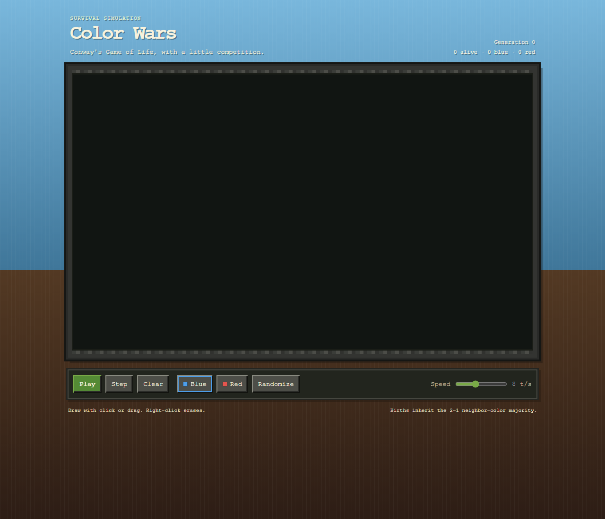

# Color Wars

A small, two-color version of Conway's Game of Life. Draw blue and red cells, then see which color wins as the simulation evolves.

## Run it

No install or build step is needed. Open `index.html` in a modern browser.

## Controls

- **Play / Pause** runs or stops the simulation.
- **Step** advances one generation; **Clear** resets the board.
- Choose **Blue** or **Red**, then click or drag on the grid to draw. Right-click erases.
- **Randomize** creates a new mixed starting field.
- Use **Speed** to set 1–20 ticks per second.

Classic Conway rules apply: live cells survive with two or three neighbors and empty cells are born with exactly three. Each newborn takes the 2–1 majority color of its three parents.
